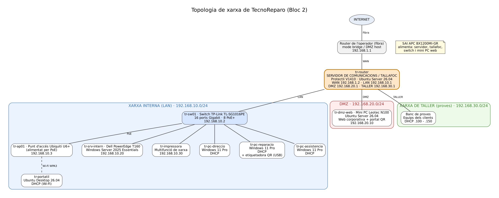

# 3. Disseny de la infraestructura i diagrama de xarxa

## 3.1. Introducció

Aquest és el disseny de l'alternativa triada en [02-alternatives-viabilitat.md](02-alternatives-viabilitat.md): una infraestructura local amb un **servidor de comunicacions** que separa la xarxa en tres zones (LAN, DMZ i taller).

## 3.2. Diagrama de xarxa

*Font editable del diagrama (Graphviz): [`img/bloc-2/diagrama-xarxa.dot`](../../../img/bloc-2/diagrama-xarxa.dot)*

## 3.3. Components i funcions

| Component | Nom | Zona | Funció |
|---|---|---|---|
| Router de l'operador | — | Exterior | Connexió de fibra a Internet. Envia tot el trànsit a `tr-router` (mode *bridge* o *DMZ host*). |
| Servidor de comunicacions | `tr-router` (Protectli V1410, Ubuntu Server 26.04) | Totes | Encamina entre zones, fa de tallafoc (iptables), NAT cap a Internet, DNAT de la web i DHCP per a LAN i taller. |
| Switch | `tr-sw01` (TP-Link TL-SG1016PE) | LAN | Connecta per cable tots els equips interns i alimenta el punt d'accés per PoE. |
| Punt d'accés | `tr-ap01` (Ubiquiti U6+) | LAN | Wi-Fi WPA3/WPA2 només per a equips de l'empresa (portàtil i mòbils dels treballadors). |
| Servidor intern | `tr-srv-intern` (Dell T160, Windows Server 2025 Essentials) | LAN | Domini, usuaris i grups, carpetes compartides, cua d'impressió i còpies de seguretat. |
| Ordinadors | `tr-pc-direccio`, `tr-pc-reparacio`, `tr-pc-assistencia` | LAN | Llocs de treball dels 3 departaments (Windows 11 Pro, units al domini). |
| Portàtil | `tr-portatil` (Ubuntu Desktop 26.04) | LAN (Wi-Fi) | Diagnòstic i proves pel taller. |
| Impressora | `tr-impressora` | LAN | Impressió i escaneig en xarxa. |
| Etiquetadora | Brother QL-800 (USB al PC de reparació) | LAN | Imprimeix els codis QR del portal de reparacions. |
| Servidor web | `tr-dmz-web` (Mini PC Leotec N100, Ubuntu Server 26.04) | DMZ | Web corporativa i portal de seguiment amb QR (Apache + PHP + MariaDB). |
| Banc de proves | — | Taller | Lloc on es connecten els equips dels clients per a actualitzar-los o provar-los. |
| SAI | APC BX1200MI-GR | — | Protegix servidor, tallafoc, switch i servidor web dels talls de llum. |

## 3.4. Connexions

| Origen | Port | Destí | Cable |
|---|---|---|---|
| Router operador | LAN | `tr-router` port 1 (WAN) | Cat 6, 2 m |
| `tr-router` | port 2 (LAN) | `tr-sw01` port 1 | Cat 6, 2 m |
| `tr-router` | port 3 (DMZ) | `tr-dmz-web` | Cat 6, 2 m |
| `tr-router` | port 4 (TALLER) | Banc de proves | Cat 6, 2 m |
| `tr-sw01` | port 2 | `tr-srv-intern` | Cat 6, 2 m |
| `tr-sw01` | ports 3–5 | 3 PC | Cat 6, 2 m (×3) |
| `tr-sw01` | port 6 | `tr-impressora` | Cat 6, 2 m |
| `tr-sw01` | port 7 (PoE+) | `tr-ap01` | Cat 6, 5 m |

Total: 9 cables de 2 m i 1 de 5 m (coincidix amb el pressupost).

**Correcció respecte a la versió anterior:** el punt d'accés Wi-Fi ja no està connectat a un PC. Ara està connectat a un port **PoE+ del switch**, que li dona xarxa i corrent pel mateix cable.

## 3.5. Decisions tècniques

1. **Servidor de comunicacions amb 4 ports físics.** Cada zona té el seu port. Així una zona no pot veure el trànsit d'una altra encara que algú configure malament un equip.
2. **DMZ només per al servidor web.** És l'únic servei que ha de ser accessible des d'Internet.
3. **Xarxa de taller aïllada.** Els equips dels clients poden portar virus. Només tenen eixida a Internet; no poden arribar a la LAN ni a la DMZ.
4. **Wi-Fi dins de la LAN i només per a l'empresa.** Els clients no tenen Wi-Fi. La contrasenya és WPA3/WPA2 i només la coneixen els treballadors.
5. **Switch gestionable amb PoE+.** Alimenta l'AP i permet fer VLAN en el futur si l'empresa creix.
6. **Servidors amb IP fixa, clients per DHCP** (detall en el document 04).

## 3.6. Serveis de la DMZ i regles del tallafoc

En la DMZ només està `tr-dmz-web`, amb:
- **HTTP/HTTPS (80/443):** web corporativa i portal de seguiment de reparacions.
- **SSH (22):** només accessible des de la LAN, per a administrar-lo.

**Per què a la DMZ:** és l'únic equip que rep connexions des d'Internet. Si un atacant el controlara, el tallafoc no el deixaria entrar a la LAN.

| Origen → Destí | Permés | Motiu |
|---|---|---|
| Internet → DMZ (80, 443) | Sí | Visites a la web i al portal QR |
| Internet → LAN / Taller | No | Protegir els equips interns |
| LAN → Internet | Sí | Treball diari |
| LAN → DMZ (443, 22) | Sí | Actualitzar estats i administrar la web |
| DMZ → LAN | **No** | Si la web és atacada, l'atacant no arriba al servidor intern |
| DMZ → Internet | Només actualitzacions (80, 443) i DNS | Mantindre el sistema actualitzat |
| Taller → Internet | Sí | Actualitzar els equips dels clients |
| Taller → LAN / DMZ | **No** | Evitar infeccions |

Aquestes regles es configuraran amb iptables en `tr-router` (Sprint 5).

## 3.7. Fonts tècniques consultades

- INCIBE – *Qué es una DMZ y cómo te puede ayudar a proteger tu empresa*: <https://www.incibe.es/empresas/blog/dmz-y-te-puede-ayudar-proteger-tu-empresa>
- INCIBE – *Separar la información pública de la interna mediante DMZ*: <https://www.incibe.es/empresas/blog/segmentacion-dmz>
- Protectli – Vault V1410 (4 × 2,5 GbE): <https://eu.protectli.com/product/v1410/>
- TP-Link TL-SG1016PE (PoE+ 802.3af/at, VLAN 802.1Q): <https://www.pccomponentes.com/tp-link-tl-sg1016pe-switch-gestionado-16-puertos-gigabit-8-puertos-poe-plus>
- Ubiquiti U6+ (PoE, 9 W): <https://www.pccomponentes.com/ubiquiti-unifi-u6-plus-punto-de-acceso-rj45-sin-inyector-poe>
- Documentació d'Ubuntu Server (Netplan): <https://ubuntu.com/server/docs>
