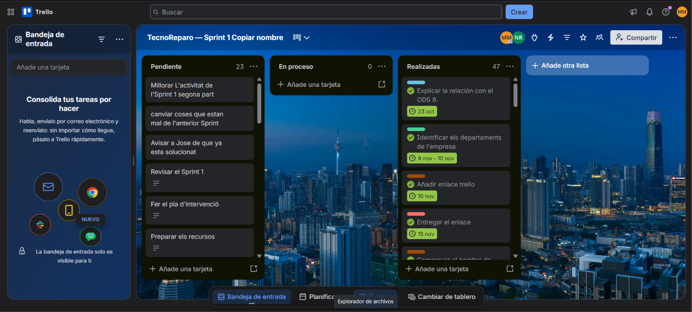

# 7. Parts del projecte i organització amb Scrum i Trello

## 7.1. Parts del projecte

| Part | Objectiu | Activitats principals | Resultat (entregable) | Responsable |
|---|---|---|---|---|
| 1. Anàlisi | Saber què necessita TecnoReparo | Revisar departaments i equips del Bloc 1, detectar problemes, fer la taula de necessitats, buscar fonts (INCIBE) | [01-necessitats.md](01-necessitats.md) | Marcos |
| 2. Disseny | Decidir i documentar la solució | Comparar alternatives, triar la B, dissenyar la topologia, fer el pla IP, triar recursos i fer el pressupost amb preus reals | Documents [02](02-alternatives-viabilitat.md), [03](03-disseny-xarxa.md), [04](04-adrecament-ip.md), [05](05-recursos.md) i [06](06-pressupost.md) | Marcos i Nicolas |
| 3. Implantació | Instal·lar i configurar la solució | Muntar el maquinari i el SAI, cablejar, configurar `tr-router` (NAT, DHCP, tallafoc), instal·lar Windows Server (domini, carpetes, impressió, còpies), unir els PC, configurar Wi-Fi, instal·lar la web i el portal QR | Infraestructura funcionant (en el laboratori: Sprints 2–5) | Marcos (xarxa) i Nicolas (sistemes i web) |
| 4. Proves | Comprovar que tot funciona i és segur | Ping entre xarxes, DHCP, accés a Internet, permisos de carpetes, impressió, restaurar una còpia, comprovar que DMZ → LAN i Taller → LAN estan bloquejats, provar el QR des d'un mòbil | Document de proves amb captures | Nicolas |
| 5. Documentació | Deixar-ho tot explicat i entregar | Documentar configuracions en Markdown, fer captures, actualitzar el README, revisar enllaços, manual curt per als treballadors i formació | Repositori de GitHub complet | Marcos |

Les parts 1 i 2 corresponen a aquest Bloc 2. Les parts 3, 4 i 5 continuen en la SA2 (Sprint 2 en endavant), on ja tenim el pla d'intervenció i les màquines virtuals.

### Ordre i dependències

```
Anàlisi → Disseny → Implantació → Proves → Documentació final
                       ↑______________|   (si una prova falla, es torna a implantació)
```

La documentació es fa durant tot el projecte, no només al final.

## 7.2. Metodologia Scrum (adaptada a l'equip)

Scrum organitza el treball en períodes curts anomenats **sprints**. Ho apliquem així:

| Element de Scrum | Com l'apliquem |
|---|---|
| Product Owner | El professorat / la direcció de TecnoReparo (diu què cal entregar) |
| Equip | Marcos i Nicolas |
| Product Backlog | Totes les targetes de la llista **Pendent** de Trello |
| Sprint | Cada bloc o sprint de l'assignatura (1–2 setmanes) |
| Sprint Planning | A l'inici de cada sessió triem les targetes i les passem a **En procés** |
| Revisió | Al final de cada sessió revisem el que està fet i ho passem a **Finalitzat** |
| Etiquetes de prioritat | ALTA, MITJANA, BAIXA i DOCS (documentació) |

## 7.3. Tauler de Trello

- **Enllaç (accessible per al professorat):** <https://trello.com/b/pQ4m9kK2/tecnoreparo-sprint-1-copiar-nombre>
- **Llistes:** Pendent, En procés i Finalitzat (en el tauler apareixen en castellà: *Pendiente*, *En proceso*, *Realizadas*).
- **Cada targeta té:** títol, breu descripció, responsable (avatar MM o NR), etiqueta de prioritat i data.



### Targetes que es veuen en la captura

| Targeta | Llista | Part del projecte |
|---|---|---|
| Identificar els departaments de l'empresa | Finalitzat | Anàlisi |
| Explicar la relació amb l'ODS 8 | Finalitzat | Documentació (Bloc 1) |
| Afegir enllaç de Trello | Finalitzat | Documentació |
| Entregar l'enllaç | Finalitzat | Documentació |
| Revisar el Sprint 1 | Pendent | Anàlisi / Disseny |
| Millorar l'activitat de l'Sprint 1 segona part | Pendent | Disseny |
| Canviar coses que estan mal de l'anterior Sprint | Pendent | Disseny |
| Avisar a Jose que ja està solucionat | Pendent | Documentació |
| Fer el pla d'intervenció | Pendent | Implantació (Sprint 2) |
| Preparar els recursos | Pendent | Implantació (Sprint 2) |

El responsable de cada targeta es veu en el tauler (avatar MM = Marcos, NR = Nicolas).

## 7.4. Diferència entre parts del projecte i Trello

Les **parts del projecte** (7.1) diuen *què* s'ha de fer i per a què. **Trello** és l'eina per a organitzar *qui* fa cada tasca i *en quin estat* està. Cada targeta de Trello pertany a una part del projecte (columna «Part» de la taula anterior).
