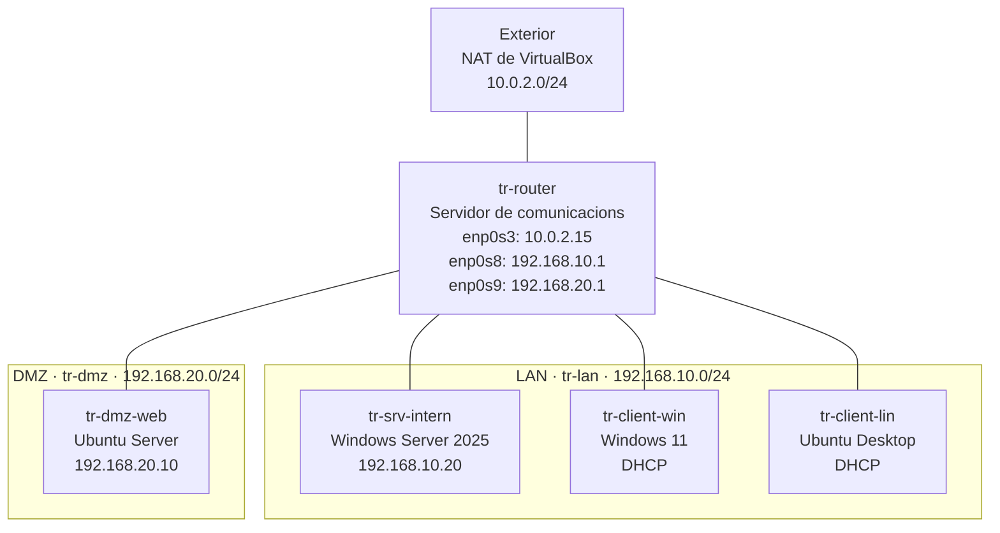

# 3. Configuració de la xarxa

En aquest apartat configurem les xarxes virtuals, els noms dels equips i les adreces IP de TecnoReparo.

## 3.1. Xarxes virtuals

| Xarxa | Mode en VirtualBox | Nom | Adreça de xarxa |
|---|---|---|---|
| Exterior | NAT | — | `10.0.2.0/24` (la dona VirtualBox) |
| LAN | Xarxa interna | `tr-lan` | `192.168.10.0/24` |
| DMZ | Xarxa interna | `tr-dmz` | `192.168.20.0/24` |

Les tres xarxes són diferents i no se solapen. Només `tr-router` té connexió a l'exterior; la resta d'equips surten a través d'ell.

## 3.2. Taula d'adreçament

| Equip | Interfície | Xarxa virtual | Mode | Adreça IP | Prefix | Passarel·la | DNS |
|---|---|---|---|---|---|---|---|
| `tr-router` | `enp0s3` | — | NAT | `10.0.2.15` (DHCP de VirtualBox) | /24 | `10.0.2.2` | `10.0.2.3` |
| `tr-router` | `enp0s8` | `tr-lan` | Xarxa interna | `192.168.10.1` | /24 | — | — |
| `tr-router` | `enp0s9` | `tr-dmz` | Xarxa interna | `192.168.20.1` | /24 | — | — |
| `tr-srv-intern` | Ethernet | `tr-lan` | Xarxa interna | `192.168.10.20` | /24 | `192.168.10.1` | — |
| `tr-client-win` | Ethernet | `tr-lan` | Xarxa interna | DHCP (`192.168.10.10`–`.19`) | /24 | `192.168.10.1` | — |
| `tr-client-lin` | `enp0s3` | `tr-lan` | Xarxa interna | DHCP (`192.168.10.10`–`.19`) | /24 | `192.168.10.1` | — |
| `tr-dmz-web` | `enp0s3` | `tr-dmz` | Xarxa interna | `192.168.20.10` | /24 | `192.168.20.1` | — |

- La ruta per defecte de `tr-router` ix per la interfície exterior (`enp0s3`).
- Els servidors tenen adreça fixa. Els clients reben l'adreça per DHCP.
- El DNS corporatiu s'instal·larà en el Sprint 3, per això encara no l'anunciem.
- Els noms de les interfícies (`enp0s3`, `enp0s8`...) poden canviar. Els comprovem amb `ip -br address`.

## 3.3. Configuració dels servidors Linux

En Ubuntu Server la xarxa es configura amb Netplan, en el fitxer `/etc/netplan/50-cloud-init.yaml`.

**`tr-router`**

```yaml
network:
  version: 2
  ethernets:
    enp0s3:
      dhcp4: true
    enp0s8:
      addresses: [192.168.10.1/24]
    enp0s9:
      addresses: [192.168.20.1/24]
```

**`tr-dmz-web`**

```yaml
network:
  version: 2
  ethernets:
    enp0s3:
      addresses: [192.168.20.10/24]
      routes:
        - to: default
          via: 192.168.20.1
```

Per aplicar els canvis:

```bash
sudo netplan apply
ip -br address
```

Per canviar el nom de l'equip:

```bash
sudo hostnamectl set-hostname tr-router
```

## 3.4. Configuració del servidor Windows

En `tr-srv-intern` configurem la IP des de *Configuració → Xarxa i Internet → Ethernet → Edita*:

- Adreça IP: `192.168.10.20`
- Màscara: `255.255.255.0`
- Passarel·la: `192.168.10.1`

El nom de l'equip el canviem des de *Configuració → Sistema → Quant a → Canvia el nom d'aquest equip*.

## 3.5. Proves inicials amb IP manual

*(Si heu posat una IP manual temporal en algun client per a fer proves abans del DHCP, indiqueu-ho ací. Si no, esborreu aquest apartat.)*

## 3.6. Diagrama de la xarxa



## 3.7. Captures


*Els tres adaptadors de `tr-router`: NAT, `tr-lan` i `tr-dmz`.*


*Resultat de `ip -br address` en `tr-router`.*


*Resultat de `ip -br address` en `tr-dmz-web`.*


*Resultat de `ipconfig /all` en `tr-srv-intern`.*
